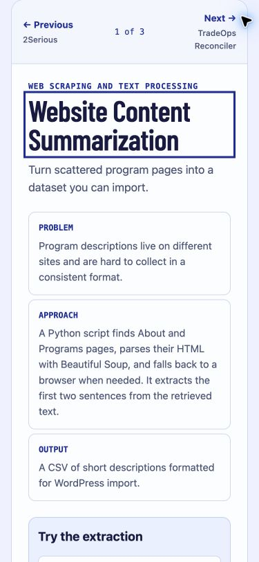
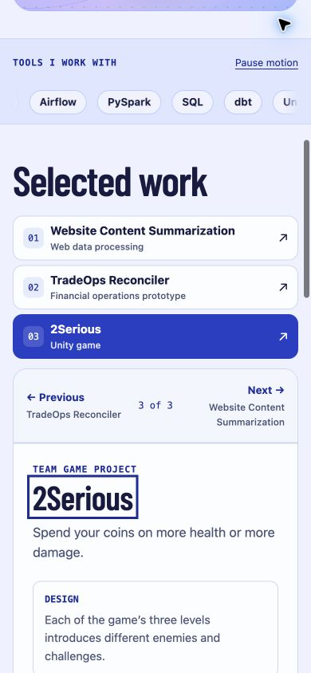
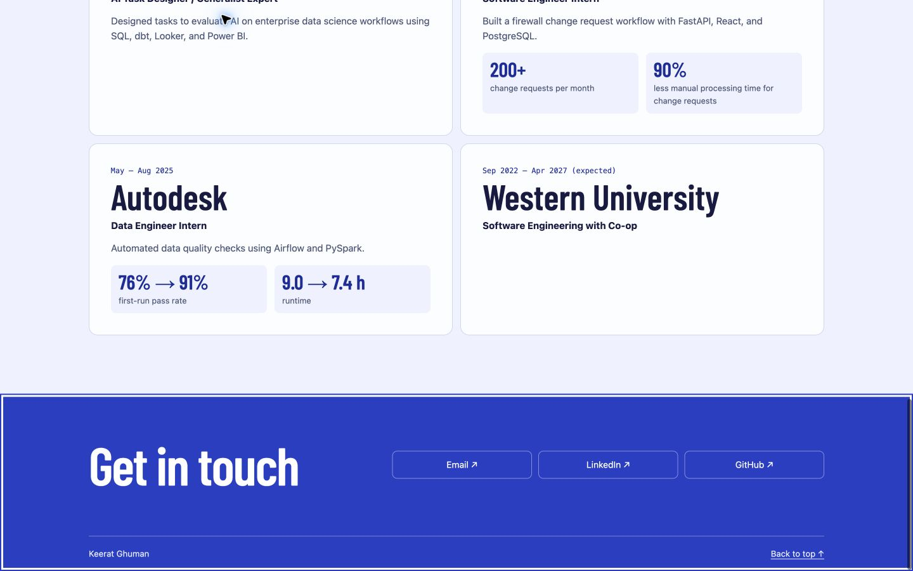

## Why

Improve keyboard navigation and visible focus states so visitors can use the portfolio without a mouse. Navigation targets and case headings receive focus, and focus outlines remain visible on light and dark backgrounds.

## Verification

The trusted gate passed JavaScript syntax and the security audit. The coordinator walked navigation, the extraction demo, case switching and browser Back/Forward at 375px and 390px, and checked desktop focus at 1440px. The phone walkthrough verified 22 focus transitions, no horizontal overflow and no visible website controls smaller than 44px.

Automatic Stop-hook enforcement has not been observed. The manual trusted gate passed.

## Review

Independent reviewer `keyboard_review`, GPT-6.2 Astra at high effort, inspected the implementation at d9bf13a and found no issues. It independently passed syntax and diff checks. Verdict ready, Scope review pass. The worker's unslop and pstack diff passes required no further changes. This PR preserves the existing visual design. The requested redesign is separate work.

## Security audit

Security audit: no findings.

## Screenshots

Phone 375px, case heading focus.

Phone 390px, case heading focus.

Desktop 1440px, contact focus.

## Asked vs delivered

Asked:
> "Website: improve keyboard navigation and visible focus states"

Delivered:
- Focusable Work, Experience, Contact and Back to top destinations, plus case heading focus during history navigation. Answers "improve keyboard navigation".
- Contrast-aware outlines, inset edge outlines and 44px phone controls. Answers "visible focus states" and the phone usability requirements.
- Gate, independent review and desktop/phone walkthrough evidence. Answers the requested end-to-end harness proof.

Not asked, suggested:
- None.

Open questions for the owner:
- None.

Scope review: pass (`keyboard_review`, GPT-6.2 Astra at high effort, implementation d9bf13a).
